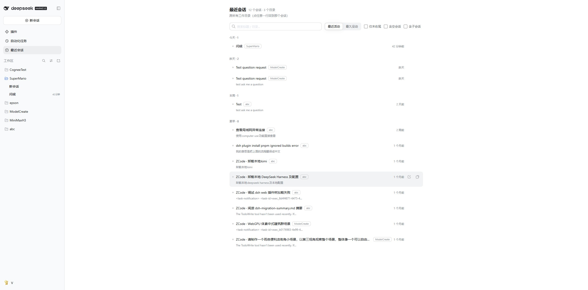

# dsh-recent-sessions

**Every session you have been working in, across every workspace, in one panel — plus a place to jot down a thought and have it come back to you when you reopen that conversation.**

A [DSH (DeepSeek Harness)](https://harness.deepseek.com) client plugin. This repository is a fork of [huangxp12/dsh-recent-sessions](https://github.com/huangxp12/dsh-recent-sessions) ([whybebabo/dsh-recent-sessions](https://github.com/whybebabo/dsh-recent-sessions)) with a native-looking UI and the floating pill / "open in a separate window" entry points removed. Both plugins register the same `recent-sessions` panel id (used as the `main` slot key and the `sidebar.panellist` id), so **do not install both**. 中文说明见 [README.md](README.md).



---

## Why this exists

DSH's sidebar groups sessions by workspace, shows the newest few rows per workspace, and only lists workspaces you registered. Once you work in a dozen directories at once, a project you have not touched for a while is simply **not on screen** — and a session that lives in a directory you were not looking for is effectively lost.

There is a second, quieter problem: the thought you have about an answer **twenty minutes later**, while doing something else, has nowhere to go. You either remember it or you lose it.

This plugin adds a **global panel** that is not tied to any session — one flat list of every session across every workspace — and a way to capture a deferred thought without waking anything up.

## What you get

- **One flat list across all workspaces.** Every session, newest first, including sessions the sidebar is currently hiding (collapsed workspaces, unregistered directories). Each row carries its workspace as a **clickable chip** — click it to filter to that workspace, click the chip in the toolbar to clear.
- **"What was I asking?"** — a second line per row with that session's last human prompt, read from the host's `turnOutline` session projection. Hover it to see a preview of the last assistant reply.
- **Time grouping and two sort orders** — Today / Yesterday / Last 7 days / Earlier; sort by **most recent** or by **least recently touched** (for cleanup — the time buckets flip as well). Pinned sessions get their own group above the time buckets.
- **Filters** — only unfinished / include blank sessions / include subagent sessions; archived sessions stay hidden by default. Your view state is remembered locally.
- **Find it again** — full-text search over message content (host index), instant local title/path filtering, and per-row actions: open the session, **reveal its folder in your file manager**, copy the path. Content hits follow the same workspace/session filters as the list.
- **Deferred thoughts.** Jot one line on any row. It is stored locally and nothing is sent. When you open that session, a **one-line strip** appears above the composer: expand it to **insert the text into your draft** (an official, undoable editor insertion), say *not now* (the thought stays, it just stops nagging), or discard.
- **Native-looking UI.** The sidebar glyph, heading scale, inputs, segmented control, state dots and row actions all use DSH's own design tokens and line icons, so the panel sits naturally next to the native session views. The status cell follows the sidebar's rules exactly: no dot while idle (the slot stays empty), a spinner while running, an amber dot plus a short trailing label for pending approvals/answers, and a green dot for an unread completion (the panel also derives that last one itself when the host does not — see below).
- **Finished while you were away.** If a session finishes while you are looking at another one, its row lights a green dot (the same one the sidebar uses) until you open it. DSH's own unread flag only fires for sessions the main view is not retaining, which is rarely true right after you switch away, so the panel watches run state itself. The panel is the reliable one here — the plugin cannot add the missing dot to the sidebar.
- **Quiet by design.** No notifications, no red badges, no auto-archiving. "Long untouched" is expressed by grouping, not by alarm.

## Install

From npm:

```bash
dsh plugin --profile <your-profile> add @whybebabo/dsh-recent-sessions
```

For local development, point it at the checkout instead:

```bash
dsh plugin --profile <your-profile> add /path/to/dsh_recent_locate
```

## How it works

Everything goes through **documented extension points** — no DOM hacks, no monkey-patching:

| What | Where |
|---|---|
| Global panel | `main` keyed slot, key `recent-sessions` |
| Sidebar entry | `sidebar.panellist` (its `id` must equal the panel key) |
| Thought strip | `conversation.input.dock` (session scope) |
| Draft insertion | `InputActions.captureInsertion()` + `insertText(text, span)` |
| Session list | root hooks `useSessions` / `useSessionStatus` / `useWorkspaces` |
| Finished while away | `ctx.uiSession.sessionStatus` subscription (`running` true→false, with `uiSession.current` telling whether you were looking at it) |
| Prompt previews | `ctx.sessions.refreshProjections(id)` → the `turnOutline` projection |
| Content search | `ctx.sessions.search(query, signal)` (results respect the current view filters) |
| Reveal folder | `ctx.remote.session.canOpenWorkspacePath()` / `openWorkspacePath({ path, action: "reveal" })` |

## Privacy and footprint

- **The host half does nothing at all** (empty `apply`): no tools, no HTTP routes, no session events. The plugin never writes to your conversations.
- Thoughts and view state live in your browser's `localStorage` only, under the key `dsh-recent-sessions:store:v1`.
- The only write path is one you trigger yourself: inserting a thought into a draft, and the message you then choose to send.
- **No build step.** `lib/client.js` is a hand-written bundle in the platform's own module format (`window.__ModuleLoader__.load({ id, factory })`), so the published tarball is two small JS files and nothing else runs at install time.

## Compatibility

- DSH `>= 0.2.0-rc.2`, declared in `engines.dsh`.
- No `@deepseek-ai/dsh-*` peer requirements are declared **on purpose**: a mismatched DSH peer range blocks activation, so the requirement stays advisory instead of becoming a hard gate.
- Node `^22.19.0 || >=24.0.0` for the host half.
- The panel requires all three root hooks (`useSessions` / `useSessionStatus` / `useWorkspaces`); if any is missing it shows a clear error instead of a half-broken render.

## Known limitations

- Prompt previews are fetched for the first 30 rows by default; enabling “Only unfinished” also fetches projections for every session whose state must be checked (bounded concurrency, persistent cache). A session whose projection fetch failed is retried after a 5-minute cooldown, on the next render.
- Bundled UI strings are Chinese and English; more locales are welcome.
- *Reveal in file manager* depends on the host reporting a desktop; the button is hidden when it does not, and falls back to copying the path.

## Development

The client half is discovered from `exports["./client"]` and served by the platform's module loader:

```js
window.__ModuleLoader__.load({
  id: "@whybebabo/dsh-recent-sessions",
  factory: (require) => {
    const React = require("react"); // ← the shell's PLATFORM_MODULES baseline
    // ...
    return module.exports;          // ← needs apply / inject
  },
});
```

`id` must equal `package.json`'s `name`: the loader claims a client bundle by package name, and a short id makes it report "loaded without registering" and the whole web boot fail.
```

Editing `lib/client.js` is picked up by a running browser within about a second (client HMR polls bundle revisions). Editing `lib/index.js` or changing the package version needs an app restart.

Run the unit tests (Node's built-in test runner, no extra dependencies):

```bash
npm test
```

## License

MIT
